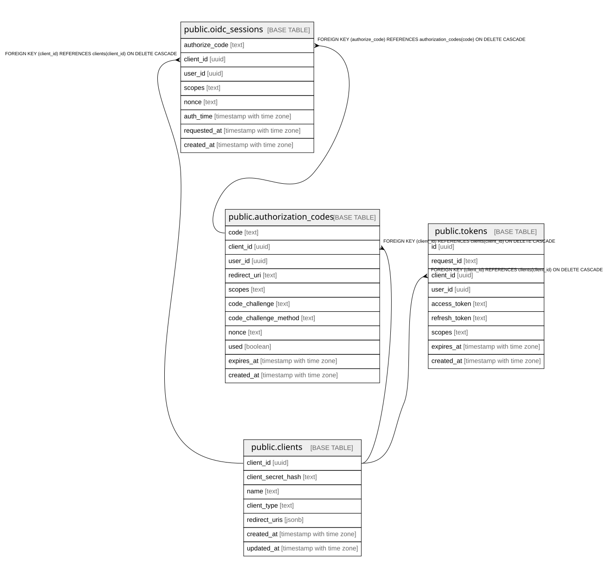

# oidc

## Description

OAuth 2.1 / OpenID Connect Provider for traP SSO.  
traP の各サービス (traQ, knoQ, NeoShowcase 等) への SSO 基盤を提供する。  

## Tables

| Name | Columns | Comment | Type | Labels |
| ---- | ------- | ------- | ---- | ------ |
| [public.clients](public.clients.md) | 15 | OAuth 2.1 / OIDC クライアントテーブル。 各サービスは Client Credentials または Authorization Code フローでトークンを取得し、 ユーザーの所属グループ情報等を取得できる。  | BASE TABLE | `OAuth2/OIDC` |
| [public.authorization_codes](public.authorization_codes.md) | 11 |  | BASE TABLE |  |
| [public.access_tokens](public.access_tokens.md) | 9 |  | BASE TABLE |  |
| [public.refresh_tokens](public.refresh_tokens.md) | 10 |  | BASE TABLE |  |
| [public.oidc_sessions](public.oidc_sessions.md) | 8 |  | BASE TABLE |  |

## Stored procedures and functions

| Name | ReturnType | Arguments | Type |
| ---- | ------- | ------- | ---- |
| public.set_updated_at | trigger |  | FUNCTION |
| public.revoke_inactive_client_sessions | trigger |  | FUNCTION |
| public.require_active_client | trigger |  | FUNCTION |

## Relations

---

> Generated by [tbls](https://github.com/k1LoW/tbls)
