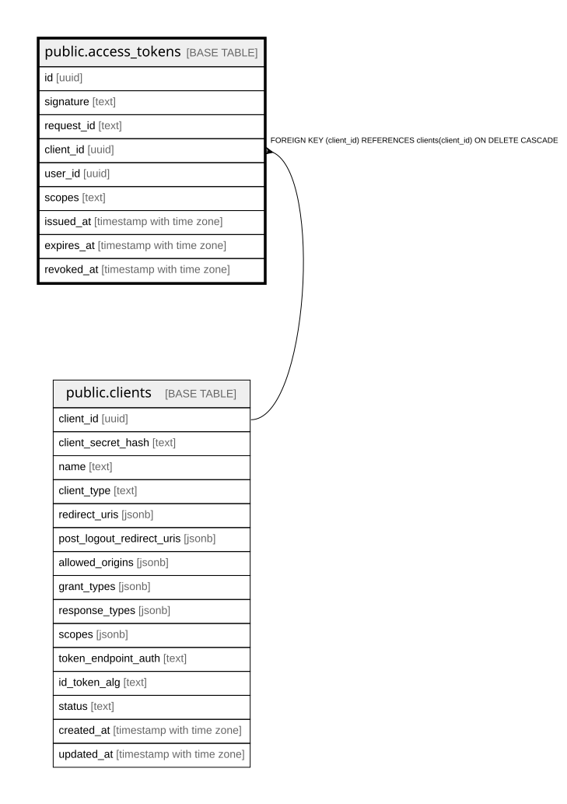

# public.access_tokens

## Columns

| Name | Type | Default | Nullable | Children | Parents | Comment |
| ---- | ---- | ------- | -------- | -------- | ------- | ------- |
| id | uuid |  | false |  |  |  |
| signature | text |  | false |  |  |  |
| request_id | text |  | false |  |  |  |
| client_id | uuid |  | false |  | [public.clients](public.clients.md) |  |
| user_id | uuid |  | true |  |  |  |
| scopes | text |  | false |  |  |  |
| issued_at | timestamp with time zone | CURRENT_TIMESTAMP | false |  |  |  |
| expires_at | timestamp with time zone |  | false |  |  |  |
| revoked_at | timestamp with time zone |  | true |  |  |  |

## Constraints

| Name | Type | Definition |
| ---- | ---- | ---------- |
| access_tokens_client_id_not_null | n | NOT NULL client_id |
| access_tokens_expires_at_not_null | n | NOT NULL expires_at |
| access_tokens_id_not_null | n | NOT NULL id |
| access_tokens_issued_at_not_null | n | NOT NULL issued_at |
| access_tokens_request_id_not_null | n | NOT NULL request_id |
| access_tokens_scopes_not_null | n | NOT NULL scopes |
| access_tokens_signature_not_null | n | NOT NULL signature |
| fk_access_tokens_client | FOREIGN KEY | FOREIGN KEY (client_id) REFERENCES clients(client_id) ON DELETE CASCADE |
| access_tokens_pkey | PRIMARY KEY | PRIMARY KEY (id) |
| idx_access_tokens_signature | UNIQUE | UNIQUE (signature) |

## Indexes

| Name | Definition |
| ---- | ---------- |
| access_tokens_pkey | CREATE UNIQUE INDEX access_tokens_pkey ON public.access_tokens USING btree (id) |
| idx_access_tokens_signature | CREATE UNIQUE INDEX idx_access_tokens_signature ON public.access_tokens USING btree (signature) |
| idx_access_tokens_client_id | CREATE INDEX idx_access_tokens_client_id ON public.access_tokens USING btree (client_id) |
| idx_access_tokens_user_id | CREATE INDEX idx_access_tokens_user_id ON public.access_tokens USING btree (user_id) |
| idx_access_tokens_request_id | CREATE INDEX idx_access_tokens_request_id ON public.access_tokens USING btree (request_id) |
| idx_access_tokens_expires_at | CREATE INDEX idx_access_tokens_expires_at ON public.access_tokens USING btree (expires_at) |

## Triggers

| Name | Definition |
| ---- | ---------- |
| trg_access_tokens_require_active_client | CREATE TRIGGER trg_access_tokens_require_active_client BEFORE INSERT ON public.access_tokens FOR EACH ROW EXECUTE FUNCTION require_active_client() |

## Relations

---

> Generated by [tbls](https://github.com/k1LoW/tbls)
