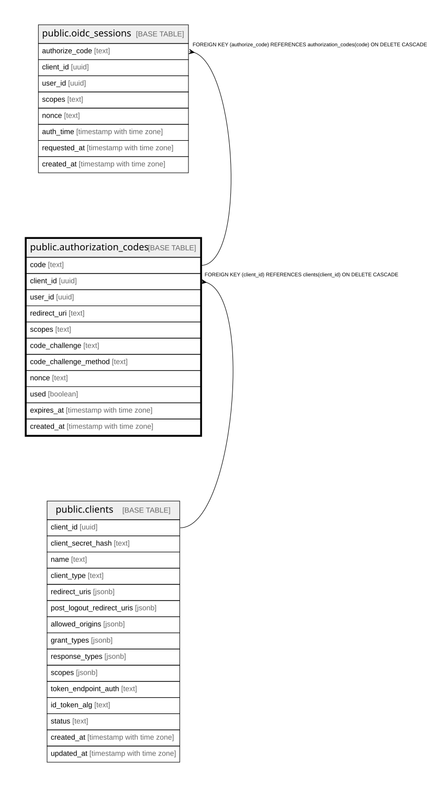

# public.authorization_codes

## Columns

| Name | Type | Default | Nullable | Children | Parents | Comment |
| ---- | ---- | ------- | -------- | -------- | ------- | ------- |
| code | text |  | false | [public.oidc_sessions](public.oidc_sessions.md) |  |  |
| client_id | uuid |  | false |  | [public.clients](public.clients.md) |  |
| user_id | uuid |  | false |  |  |  |
| redirect_uri | text |  | false |  |  |  |
| scopes | text |  | false |  |  |  |
| code_challenge | text |  | true |  |  |  |
| code_challenge_method | text |  | true |  |  |  |
| nonce | text |  | true |  |  |  |
| used | boolean | false | false |  |  |  |
| expires_at | timestamp with time zone |  | false |  |  |  |
| created_at | timestamp with time zone | CURRENT_TIMESTAMP | false |  |  |  |

## Constraints

| Name | Type | Definition |
| ---- | ---- | ---------- |
| authorization_codes_client_id_not_null | n | NOT NULL client_id |
| authorization_codes_code_not_null | n | NOT NULL code |
| authorization_codes_created_at_not_null | n | NOT NULL created_at |
| authorization_codes_expires_at_not_null | n | NOT NULL expires_at |
| authorization_codes_redirect_uri_not_null | n | NOT NULL redirect_uri |
| authorization_codes_scopes_not_null | n | NOT NULL scopes |
| authorization_codes_used_not_null | n | NOT NULL used |
| authorization_codes_user_id_not_null | n | NOT NULL user_id |
| fk_authorization_codes_client | FOREIGN KEY | FOREIGN KEY (client_id) REFERENCES clients(client_id) ON DELETE CASCADE |
| authorization_codes_pkey | PRIMARY KEY | PRIMARY KEY (code) |

## Indexes

| Name | Definition |
| ---- | ---------- |
| authorization_codes_pkey | CREATE UNIQUE INDEX authorization_codes_pkey ON public.authorization_codes USING btree (code) |
| idx_authorization_codes_client_id | CREATE INDEX idx_authorization_codes_client_id ON public.authorization_codes USING btree (client_id) |
| idx_authorization_codes_expires_at | CREATE INDEX idx_authorization_codes_expires_at ON public.authorization_codes USING btree (expires_at) |

## Triggers

| Name | Definition |
| ---- | ---------- |
| trg_authorization_codes_require_active_client | CREATE TRIGGER trg_authorization_codes_require_active_client BEFORE INSERT ON public.authorization_codes FOR EACH ROW EXECUTE FUNCTION require_active_client() |

## Relations

---

> Generated by [tbls](https://github.com/k1LoW/tbls)
