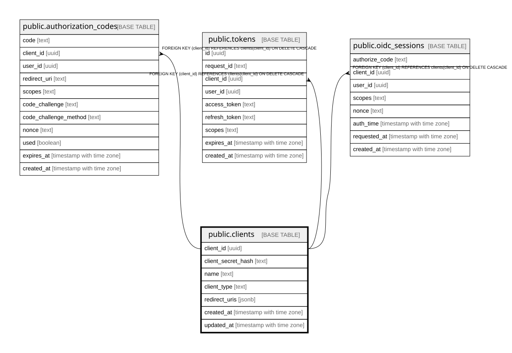

# public.clients

## Description

OAuth 2.1 / OIDC クライアントテーブル。  
各サービスは Client Credentials または Authorization Code フローでトークンを取得し、  
ユーザーの所属グループ情報等を取得できる。  

## Labels

`OAuth2/OIDC`

## Columns

| Name | Type | Default | Nullable | Children | Parents | Comment |
| ---- | ---- | ------- | -------- | -------- | ------- | ------- |
| client_id | uuid |  | false | [public.authorization_codes](public.authorization_codes.md) [public.tokens](public.tokens.md) [public.oidc_sessions](public.oidc_sessions.md) |  | クライアントUUID (RFC 7591準拠) |
| client_secret_hash | text |  | true |  |  | ハッシュ化されたクライアントシークレット (confidential client用、public clientはNULL) |
| name | text |  | false |  |  | クライアント名 (traQ, knoQ, NeoShowcase等) |
| client_type | text |  | false |  |  | クライアントタイプ: - public: SPA等のシークレットを安全に保持できないクライアント - confidential: サーバーサイドでシークレットを保持できるクライアント  |
| redirect_uris | jsonb |  | false |  |  | OAuth認可後のリダイレクトURI (JSON配列、複数環境対応) |
| created_at | timestamp with time zone | CURRENT_TIMESTAMP | false |  |  | 作成日時 |
| updated_at | timestamp with time zone | CURRENT_TIMESTAMP | false |  |  | 更新日時 |

## Constraints

| Name | Type | Definition | Comment |
| ---- | ---- | ---------- | ------- |
| clients_client_id_not_null | n | NOT NULL client_id |  |
| clients_client_type_not_null | n | NOT NULL client_type |  |
| clients_created_at_not_null | n | NOT NULL created_at |  |
| clients_name_not_null | n | NOT NULL name |  |
| clients_redirect_uris_not_null | n | NOT NULL redirect_uris |  |
| clients_updated_at_not_null | n | NOT NULL updated_at |  |
| clients_pkey | PRIMARY KEY | PRIMARY KEY (client_id) | 主キー |

## Indexes

| Name | Definition | Comment |
| ---- | ---------- | ------- |
| clients_pkey | CREATE UNIQUE INDEX clients_pkey ON public.clients USING btree (client_id) | 主キー |

## Triggers

| Name | Definition |
| ---- | ---------- |
| trg_clients_set_updated_at | CREATE TRIGGER trg_clients_set_updated_at BEFORE UPDATE ON public.clients FOR EACH ROW EXECUTE FUNCTION set_updated_at() |

## Relations

---

> Generated by [tbls](https://github.com/k1LoW/tbls)
