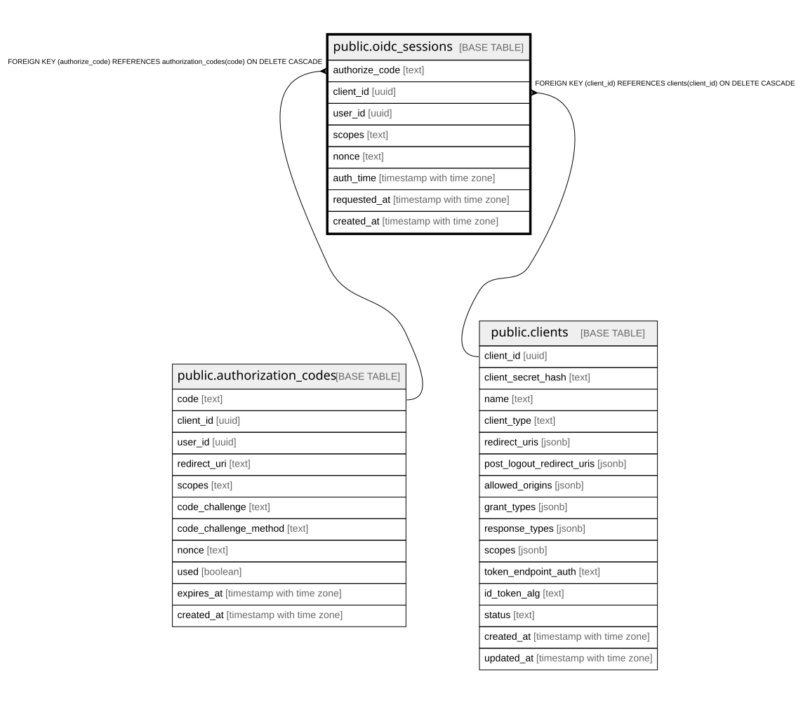

# public.oidc_sessions

## Columns

| Name | Type | Default | Nullable | Children | Parents | Comment |
| ---- | ---- | ------- | -------- | -------- | ------- | ------- |
| authorize_code | text |  | false |  | [public.authorization_codes](public.authorization_codes.md) |  |
| client_id | uuid |  | false |  | [public.clients](public.clients.md) |  |
| user_id | uuid |  | false |  |  |  |
| scopes | text |  | false |  |  |  |
| nonce | text |  | true |  |  |  |
| auth_time | timestamp with time zone | CURRENT_TIMESTAMP | false |  |  |  |
| requested_at | timestamp with time zone |  | false |  |  |  |
| created_at | timestamp with time zone | CURRENT_TIMESTAMP | false |  |  |  |

## Constraints

| Name | Type | Definition |
| ---- | ---- | ---------- |
| oidc_sessions_auth_time_not_null | n | NOT NULL auth_time |
| oidc_sessions_authorize_code_not_null | n | NOT NULL authorize_code |
| oidc_sessions_client_id_not_null | n | NOT NULL client_id |
| oidc_sessions_created_at_not_null | n | NOT NULL created_at |
| oidc_sessions_requested_at_not_null | n | NOT NULL requested_at |
| oidc_sessions_scopes_not_null | n | NOT NULL scopes |
| oidc_sessions_user_id_not_null | n | NOT NULL user_id |
| fk_oidc_sessions_client | FOREIGN KEY | FOREIGN KEY (client_id) REFERENCES clients(client_id) ON DELETE CASCADE |
| fk_oidc_sessions_authorize_code | FOREIGN KEY | FOREIGN KEY (authorize_code) REFERENCES authorization_codes(code) ON DELETE CASCADE |
| oidc_sessions_pkey | PRIMARY KEY | PRIMARY KEY (authorize_code) |

## Indexes

| Name | Definition |
| ---- | ---------- |
| oidc_sessions_pkey | CREATE UNIQUE INDEX oidc_sessions_pkey ON public.oidc_sessions USING btree (authorize_code) |
| idx_oidc_sessions_client_id | CREATE INDEX idx_oidc_sessions_client_id ON public.oidc_sessions USING btree (client_id) |

## Triggers

| Name | Definition |
| ---- | ---------- |
| trg_oidc_sessions_require_active_client | CREATE TRIGGER trg_oidc_sessions_require_active_client BEFORE INSERT ON public.oidc_sessions FOR EACH ROW EXECUTE FUNCTION require_active_client() |

## Relations

---

> Generated by [tbls](https://github.com/k1LoW/tbls)
