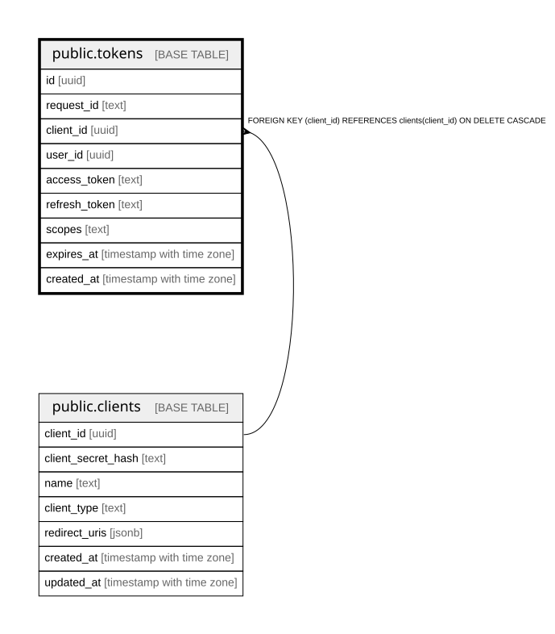

# public.tokens

## Columns

| Name | Type | Default | Nullable | Children | Parents | Comment |
| ---- | ---- | ------- | -------- | -------- | ------- | ------- |
| id | uuid |  | false |  |  |  |
| request_id | text |  | false |  |  |  |
| client_id | uuid |  | false |  | [public.clients](public.clients.md) |  |
| user_id | uuid |  | false |  |  |  |
| access_token | text |  | true |  |  |  |
| refresh_token | text |  | true |  |  |  |
| scopes | text |  | false |  |  |  |
| expires_at | timestamp with time zone |  | false |  |  |  |
| created_at | timestamp with time zone | CURRENT_TIMESTAMP | false |  |  |  |

## Constraints

| Name | Type | Definition |
| ---- | ---- | ---------- |
| chk_tokens_at_least_one_token | CHECK | CHECK (((access_token IS NOT NULL) OR (refresh_token IS NOT NULL))) |
| tokens_client_id_not_null | n | NOT NULL client_id |
| tokens_created_at_not_null | n | NOT NULL created_at |
| tokens_expires_at_not_null | n | NOT NULL expires_at |
| tokens_id_not_null | n | NOT NULL id |
| tokens_request_id_not_null | n | NOT NULL request_id |
| tokens_scopes_not_null | n | NOT NULL scopes |
| tokens_user_id_not_null | n | NOT NULL user_id |
| fk_tokens_client | FOREIGN KEY | FOREIGN KEY (client_id) REFERENCES clients(client_id) ON DELETE CASCADE |
| tokens_pkey | PRIMARY KEY | PRIMARY KEY (id) |
| idx_tokens_access_token | UNIQUE | UNIQUE (access_token) |

## Indexes

| Name | Definition |
| ---- | ---------- |
| tokens_pkey | CREATE UNIQUE INDEX tokens_pkey ON public.tokens USING btree (id) |
| idx_tokens_access_token | CREATE UNIQUE INDEX idx_tokens_access_token ON public.tokens USING btree (access_token) |
| idx_tokens_refresh_token | CREATE UNIQUE INDEX idx_tokens_refresh_token ON public.tokens USING btree (refresh_token) |
| idx_tokens_client_id | CREATE INDEX idx_tokens_client_id ON public.tokens USING btree (client_id) |
| idx_tokens_user_id | CREATE INDEX idx_tokens_user_id ON public.tokens USING btree (user_id) |
| idx_tokens_request_id | CREATE INDEX idx_tokens_request_id ON public.tokens USING btree (request_id) |
| idx_tokens_expires_at | CREATE INDEX idx_tokens_expires_at ON public.tokens USING btree (expires_at) |

## Relations

---

> Generated by [tbls](https://github.com/k1LoW/tbls)
